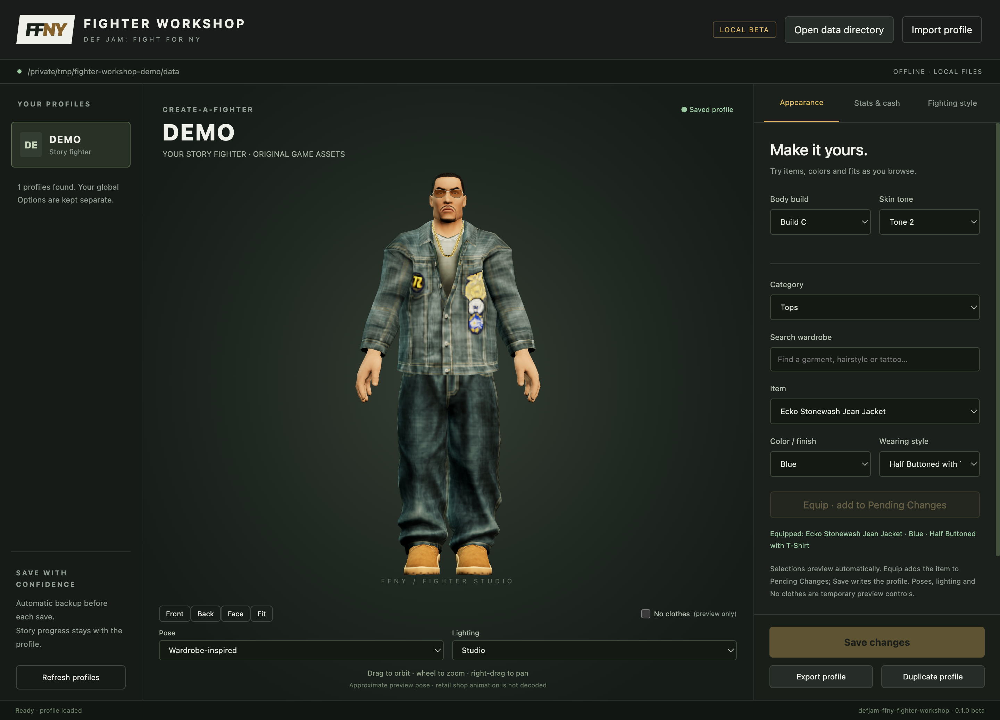
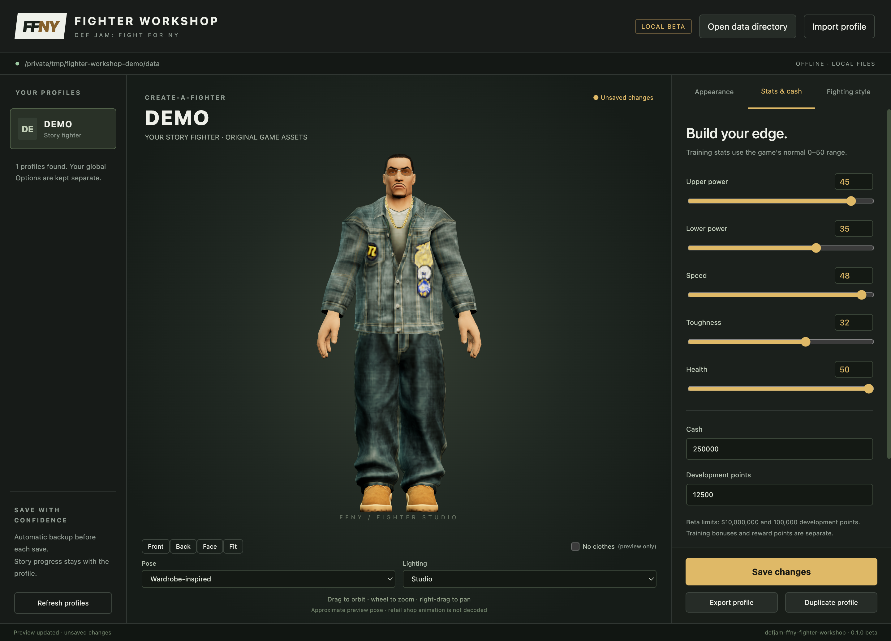
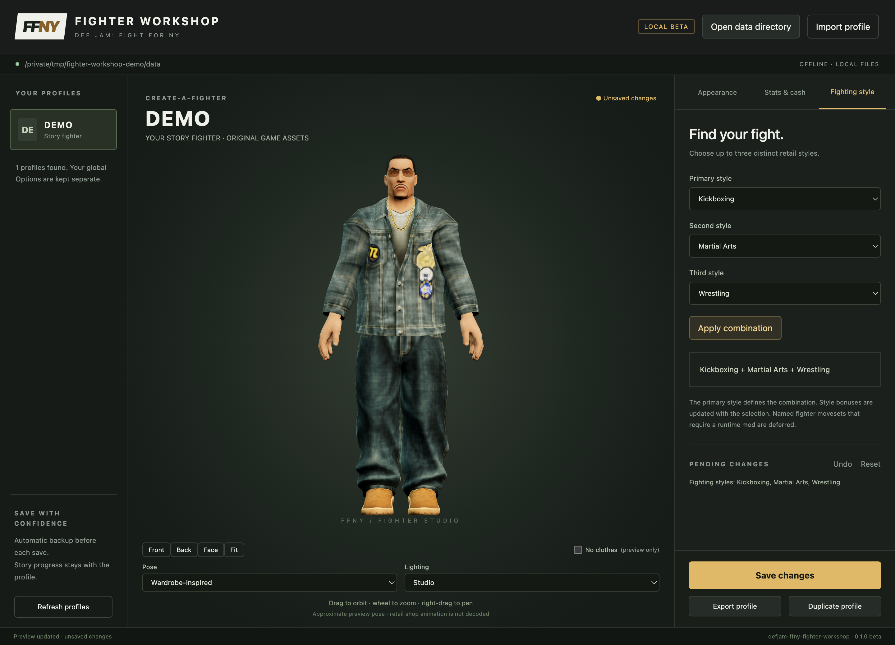
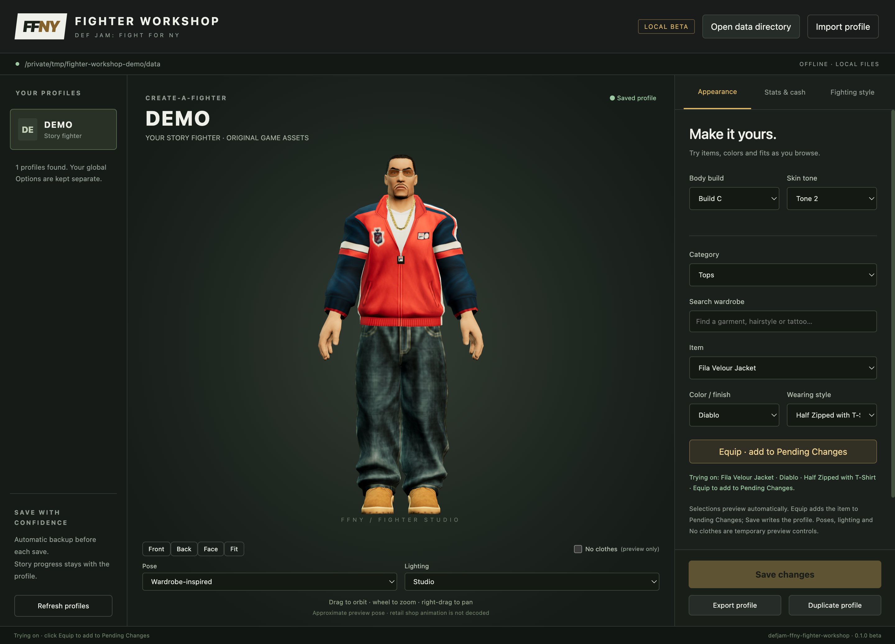

# Def Jam FFNY Fighter Workshop

A standalone, offline desktop Create-a-Fighter and save editor for **Def Jam:
Fight for NY Recomp**, targeting Windows, macOS and Linux.

**0.1 Beta 1** — [Download the prerelease](https://github.com/vyanhursky/defjam-ffny-fighter-workshop/releases/tag/v0.1.0-beta.1).
Standalone packages include Python and Qt; no Python installation is required.

| Platform | Download |
| --- | --- |
| Windows x64 | [ZIP](https://github.com/vyanhursky/defjam-ffny-fighter-workshop/releases/download/v0.1.0-beta.1/defjam-ffny-fighter-workshop-0.1.0b1-windows-x64.zip) |
| macOS Apple Silicon | [ZIP](https://github.com/vyanhursky/defjam-ffny-fighter-workshop/releases/download/v0.1.0-beta.1/defjam-ffny-fighter-workshop-0.1.0b1-macos-arm64.zip) |
| macOS Intel | [ZIP](https://github.com/vyanhursky/defjam-ffny-fighter-workshop/releases/download/v0.1.0-beta.1/defjam-ffny-fighter-workshop-0.1.0b1-macos-x64.zip) |
| Linux x64 | [tar.gz](https://github.com/vyanhursky/defjam-ffny-fighter-workshop/releases/download/v0.1.0-beta.1/defjam-ffny-fighter-workshop-0.1.0b1-linux-x64.tar.gz) |

Checksums accompany each package. Windows functional checks, all 29 local Apple
Silicon editor checks, and native build/startup CI on all four targets pass.
This is a beta; broader native editor/game acceptance remains ongoing.

Local beta: browse existing profiles, preview the saved fighter in 3D, edit
appearance, training stats, cash, development points and retail CAF style
combinations. Save with an original-profile backup, export/import a complete
profile, or duplicate it under a new ID while retaining Story progress.

Items, colors and fits preview immediately as you browse. **Equip** adds the
choice to Pending Changes; **Save changes** writes the profile. Tattoo categories
are grouped and named by body area. **No clothes** temporarily hides apparel and
accessories, retaining underwear, so tattoos are easier to inspect.

The viewer offers Wardrobe-inspired, Relaxed and source T-pose, plus Studio,
Warm shop, Cool rim and Texture reference lighting. Wardrobe-inspired and Relaxed
use approximate preview deformation, not the retail shop animation. Uncommitted
try-ons are excluded from saves and exports. Equip stages an item; clothing
visibility, pose and lighting always remain preview-only.

## Screenshots

Captured from the macOS app with a disposable DEMO profile and original assets
decoded locally from the user's own game files.

**Main window** — browse profiles and preview your fighter.



**Stats and cash** — adjust the five training stats, cash and development points.



**Fighting-style combinations** — combine up to three retail fighting styles.



**Clothing try-on** — preview items, colors and fits before adding them to Pending Changes.



On macOS, open the `.app`. On Windows or Linux, keep the complete application
folder together and launch its executable.
On macOS, the app automatically opens the installer's default
`~/Library/Application Support/DefJamRecompiled/data` directory when it contains
FFNY saves. Use **Open data directory** or `--data` to select another directory
containing `save` and `extracted`. Start with separate copies of your saves and close the game using
those copies before editing. Original game assets are decoded locally; nothing
is uploaded or downloaded at runtime.

**Export** includes staged changes and the complete profile. **Duplicate** creates
a separate profile with staged changes and a new 1–7 character uppercase/digit
ID. **Import** installs into the selected directory and refuses name collisions.
**Save profile** changes the selected profile after creating a `.djprofile` backup
in the editor workspace's `backups` directory.

See [the test guide](docs/beta-test-guide.md) and [validation](docs/validation.md).

```sh
python -m pip install -e '.[desktop,dev,build]'
defjam-caf-desktop --data /path/to/recomp-data
defjam-caf inspect --data /path/to/recomp-data
python -m pytest -q
node --test tests/poses.test.mjs
python scripts/package_desktop.py
```

Point at the Recomp data directory containing `save` and `extracted`. The inspector
also accepts a `save`, `UserData`, or title-save directory. Inspection never writes
to the selected data directory. It distinguishes global Options from profiles,
preserves legacy folder identities and reports ambiguous or invalid entries.

See [the agreed scope](docs/specification.md), [format evidence](docs/save-format.md)
and [development status](PROGRESS.md). Game assets and saves are not distributed.
Preview assets are derived locally from the user's own game files. Initial
conversion takes several minutes; later launches reuse a private cache.

Builds use PyInstaller and include their own Python runtime; the target machine
does not require Python. Build on each target OS. The packaging script produces
a macOS `.app`/ZIP, Windows ZIP, or Linux `.tar.gz`, with SHA-256 sidecars. See
[desktop platforms](docs/desktop-platforms.md) for prerequisites, launch commands,
workspace paths and validation. Native CI checks each package after relocation;
CI startup checks do not replace game acceptance.
`requirements-tested.txt` records the local Windows build environment.

If a restricted Windows build workspace labels generated files Low integrity,
Qt's sandboxed renderer cannot start. In a normal PowerShell session, restore
only the generated app folder to the ordinary Medium level, then verify the
packaged preview:

```powershell
icacls 'dist\defjam-ffny-fighter-workshop' /setintegritylevel '(OI)(CI)M' /T /Q
```

This does not disable Chromium sandboxing or change Windows security policy.
