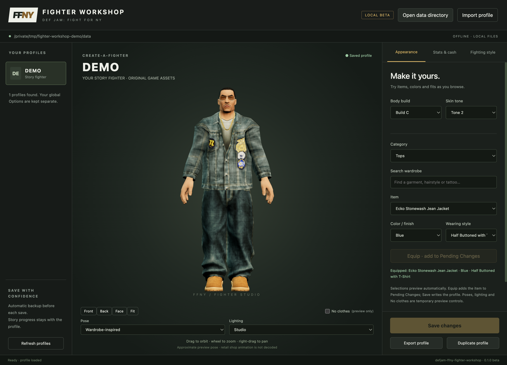
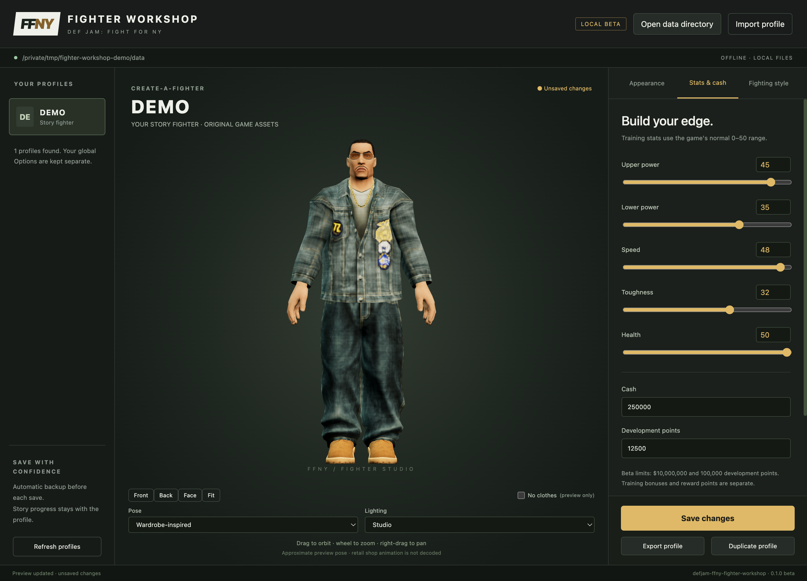
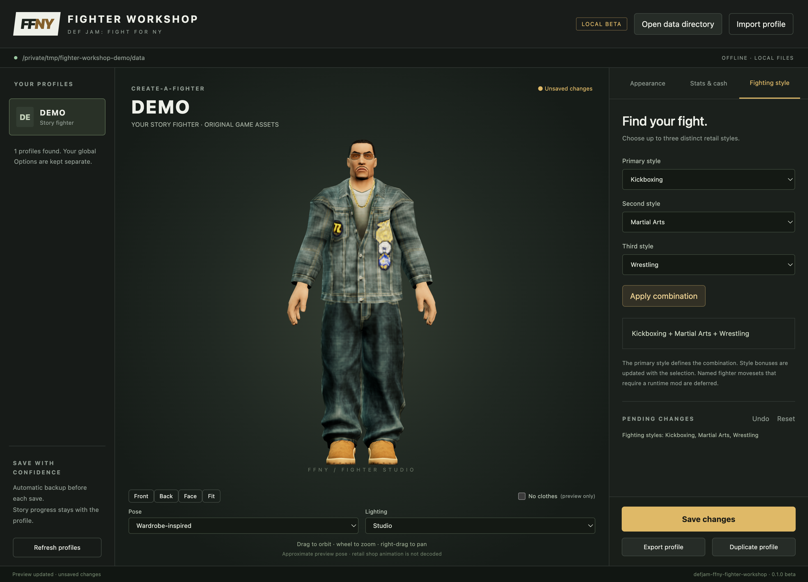
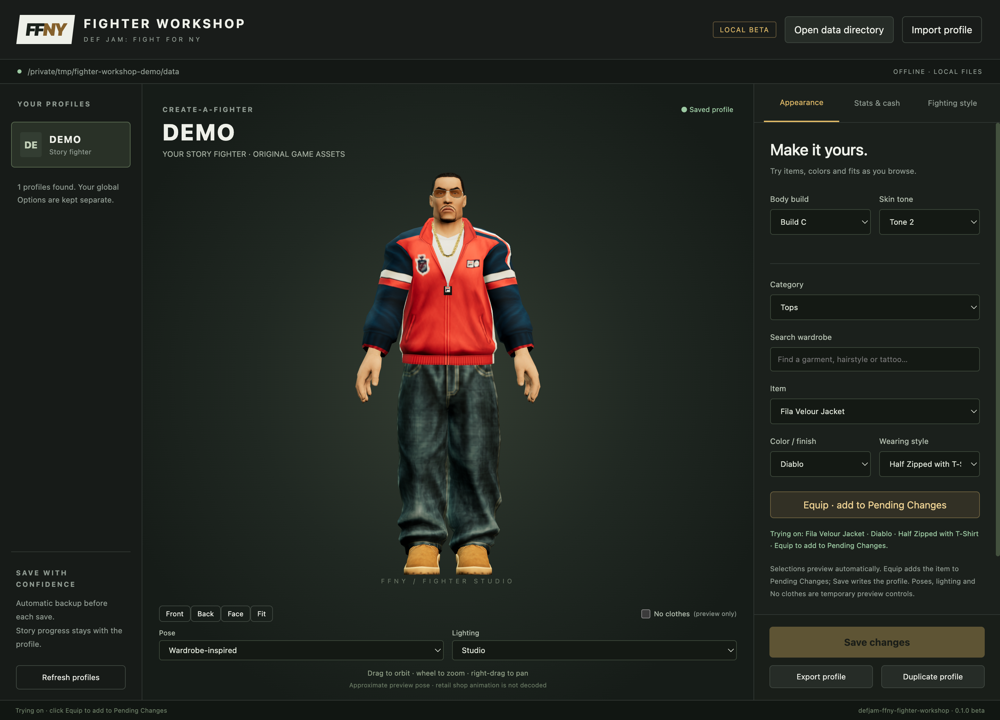

# Def Jam FFNY Fighter Workshop

A standalone, offline desktop Create-a-Fighter and save editor for **Def Jam:
Fight for NY Recomp**, targeting Windows, macOS and Linux.

**0.1 Beta 2** — [Download the prerelease](https://github.com/vyanhursky/defjam-ffny-fighter-workshop/releases/tag/v0.1.0-beta.2).
Standalone packages include Python and Qt; no Python installation is required.

| Platform | Download |
| --- | --- |
| Windows x64 | [ZIP](https://github.com/vyanhursky/defjam-ffny-fighter-workshop/releases/download/v0.1.0-beta.2/defjam-ffny-fighter-workshop-0.1.0b2-windows-x64.zip) |
| macOS Apple Silicon | [ZIP](https://github.com/vyanhursky/defjam-ffny-fighter-workshop/releases/download/v0.1.0-beta.2/defjam-ffny-fighter-workshop-0.1.0b2-macos-arm64.zip) |
| macOS Intel | [ZIP](https://github.com/vyanhursky/defjam-ffny-fighter-workshop/releases/download/v0.1.0-beta.2/defjam-ffny-fighter-workshop-0.1.0b2-macos-x64.zip) |
| Linux x64 | [tar.gz](https://github.com/vyanhursky/defjam-ffny-fighter-workshop/releases/download/v0.1.0-beta.2/defjam-ffny-fighter-workshop-0.1.0b2-linux-x64.tar.gz) |

Checksums accompany each package. Windows functional checks, all 29 local Apple
Silicon editor checks, and native build/startup CI on all four targets pass.
This is a beta; broader native editor/game acceptance remains ongoing.

Workshop 0.1 Beta 2 opens on four workflows: **Story character editor**,
**Fighter from a Create-a-Fighter**, **Fighter from a retail fighter**, and
**Retail fighter editor**. **Game setup** remembers the game/data folders and
shows which installed build supports each feature. Project exports pair with
**Recomp 1.2.0 beta 2** or a compatible source checkout; stable Recomp 1.2.0
lacks these authoring tools.

## Terminology

A **Story profile** contains career progress, inventory and currency. A
**project** (`.ffnyfighter`) holds fighter settings and imported artwork without
Story progress. An **outfit** is one selectable look. The **game version/runtime**
is the Recomp build that compiles an export **recipe**. All guides use the
shared [terminology](docs/terminology.md).

## Edit a Story fighter

Browse existing profiles, preview the fighter in 3D and edit appearance, original
facial presets, training stats, cash, development points and moves. **Moves**
combines CAF styles, original retail movesets and four Blazin' assignments.
Direct Story retail-moveset edits require acknowledging their game-compatibility
notice. Save makes an original-profile backup. Export/import transfers the full
profile; Duplicate creates a separate identity while keeping Story progress.

Items, colors and fits preview as you browse. **Equip** stages the choice;
**Save changes** writes it. No clothes temporarily hides apparel/accessories for
tattoo inspection. Pose, lighting and uncommitted try-ons remain preview-only.
Wardrobe-inspired and Relaxed are approximate deformation; source T-pose is also
available. The viewer does not reproduce the full native animation/shader system.

## Build an exportable fighter

[CAF projects](docs/fighter-projects.md) include metadata, up to three selectable
outfits, portrait capture/import, experimental face sliders/template sculpt import,
and square 256–2048 px PNG atlases. Outfits share stats/moves/performance, with
individual appearance and artwork. [Voice, entrance/victory and AI tools](docs/performance-editor.md)
use the selected game's catalogs, support original source-track playback within
explicit limits, and keep unsupported resources unavailable.

**Menu artwork** supplies six master images or 24 individual 2/3/4-player roles,
with shared defaults, outfit overrides, independent UI donors and HD output.
Save writes the whole project. **Export mod…** produces a validated Custom
Fighter Mod ZIP, then the compatible game's **Mods → Fighters** installs it.
Export does not install or activate the pack.

Current source adds a project/outfit sidebar, grouped keyboard tabs, automatic
Voice/Entrance/AI catalogs and pinned **Save project** / **Export mod…** actions.
Export checks readiness and saves staged edits before the ZIP chooser. The
published Beta 2 packages predate these review workflow updates; the guides
describe the current source UI.

[Retail projects](docs/retail-fighter-projects.md) start from original fighters,
with independent body/combat/UI donors, ordinary pack import, native stats,
resource components and HD RGB/UI artwork. **Retail fighter editor** supports
[appearance replacement and extra outfits](docs/retail-overrides-outfits.md)
while retaining the original combat identity. Experimental [PS2 snapshot recovery](docs/ps2-caf-recovery.md)
can create a CAF project without converting a Story save. Compilation success
and native game acceptance remain separate; see the
[Beta 2 release notes](docs/releases/v0.1.0-beta.2.md) for qualification limits.

## Screenshots

Captured from the macOS app with a disposable DEMO profile and original assets
decoded locally from the user's own game files.

**Main window** — browse profiles and preview your fighter.



**Stats and cash** — adjust the five training stats, cash and development points.



**Fighting-style combinations** — combine up to three retail fighting styles.



**Clothing try-on** — preview items, colors and fits before adding them to Pending Changes.



On macOS, open the `.app`. On Windows or Linux, keep the complete application
folder together and launch its executable.
On macOS, the app automatically opens the installer's default
`~/Library/Application Support/DefJamRecompiled/data` directory when it contains
FFNY saves. Use **Game setup** or `--data` to select another directory
containing `save` and `extracted`. Start with separate copies of your saves and close the game using
those copies before editing. Original game assets are decoded locally; nothing
is uploaded or downloaded at runtime.

**Export** includes staged changes and the complete profile. **Duplicate** creates
a separate profile with staged changes and a new 1–7 character uppercase/digit
ID. **Import** installs into the selected directory and refuses name collisions.
**Save profile** changes the selected profile after creating a `.djprofile` backup
in the editor workspace's `backups` directory.

See [the test guide](docs/beta-test-guide.md) and [validation](docs/validation.md).

```sh
python -m pip install -e '.[desktop,dev,build]'
defjam-caf-desktop --data /path/to/recomp-data
defjam-caf inspect --data /path/to/recomp-data
python -m pytest -q
node --test tests/poses.test.mjs
python scripts/package_desktop.py
```

Point at the Recomp data directory containing `save` and `extracted`. The inspector
also accepts a `save`, `UserData`, or title-save directory. Inspection never writes
to the selected data directory. It distinguishes global Options from profiles,
preserves legacy folder identities and reports ambiguous or invalid entries.

See [the agreed scope](docs/specification.md), [format evidence](docs/save-format.md)
and [development status](PROGRESS.md). Game assets and saves are not distributed.
Preview assets are derived locally from the user's own game files. Initial
conversion takes several minutes; later launches reuse a private cache.

Builds use PyInstaller and include their own Python runtime; the target machine
does not require Python. Build on each target OS. The packaging script produces
a macOS `.app`/ZIP, Windows ZIP, or Linux `.tar.gz`, with SHA-256 sidecars. See
[desktop platforms](docs/desktop-platforms.md) for prerequisites, launch commands,
workspace paths and validation. Native CI checks each package after relocation;
CI startup checks do not replace game acceptance.
`requirements-tested.txt` records the local Windows build environment.

If a restricted Windows build workspace labels generated files Low integrity,
Qt's sandboxed renderer cannot start. In a normal PowerShell session, restore
only the generated app folder to the ordinary Medium level, then verify the
packaged preview:

```powershell
icacls 'dist\defjam-ffny-fighter-workshop' /setintegritylevel '(OI)(CI)M' /T /Q
```

This does not disable Chromium sandboxing or change Windows security policy.

## License

Copyright © 2026 Vlad Yanhursky. The Workshop's original software and
documentation are licensed under [GNU GPL version 3 only](LICENSE)
(`GPL-3.0-only`). Distributed modified versions must remain under the GPL and
provide corresponding source as required by the license. Preserve the applicable
copyright and license notices; see [COPYRIGHT](COPYRIGHT).

Third-party components retain their own licenses and attribution, listed in
[THIRD_PARTY.md](THIRD_PARTY.md). Game artwork, saves and imported/exported
fighter artwork are outside the Workshop software license. Earlier MIT releases
retain their original licensing terms.
